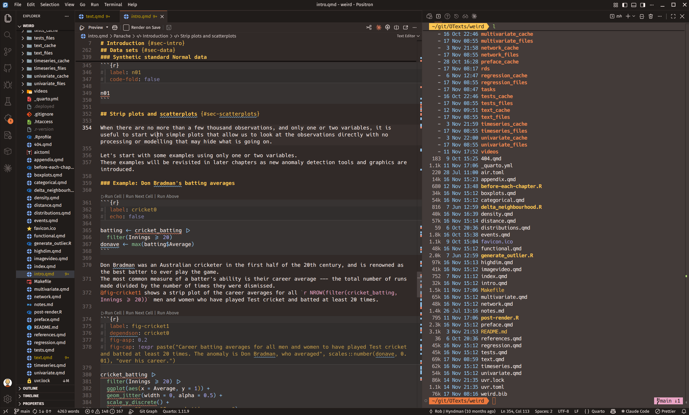

# Outback

A warm dark theme with colours inspired by Central Australia: red earth, ochre, spinifex gold and a clear desert sky.
It is tuned for reading and writing Quarto documents and R code, and works well with any language.

Outback is available for [Positron and VS Code](#positron-and-vs-code), [RStudio](#rstudio), [Zed](#zed), [Konsole](#konsole), [KDE Plasma](#kde-plasma), [batcat](#batcat), [eza](#eza), [Zen](#zen) and [Sublime Merge](#sublime-merge).



## Colours

| Element                                            | Colour                        |
| ---                                                | ---                           |
| Headings                                           | spinifex `#ffc852`, bold      |
| Strings                                            | spinifex `#ffc852`            |
| Inline code                                        | desert rose `#eaa6c6`         |
| Link text                                          | sunset `#f48d6e`              |
| Link URLs, function names and inserted text        | sage `#8cc496`                |
| YAML keys and cross-references such as `@fig-beer` | ochre `#ee7a3c`               |
| Maths                                              | eucalyptus `#abc4b8`          |
| Comments and `::: {.content-hidden}` divs          | smoke `#736968`               |
| Operators such as `\|>`, `<-` and `+`              | sky `#94c8f0`                 |
| Keywords such as `if`, `for` and `function`        | mulla-mulla `#c9a8f0`         |
| Bold and italic text                               | wattle seed `#d9a93c`         |
| Numbers and constants such as `TRUE` and `NULL`    | dusk `#a9a9e9`                |
| Types, classes and attribute names                 | waterhole `#86daca`           |
| Variables and other text                           | ghost gum `#fff2f0`           |
| Brackets, by nesting level                         | sky, wattle seed, desert rose |

In the interface, ochre marks buttons, focus, the active tab and errors; badges are spinifex; and added lines in diffs and git decorations are new growth `#aeda76`.

## Quarto and Markdown

- Heading labels such as `{#sec-intro}` are shown in the heading colour but not bold, so they stand apart from the heading text.
- Everything inside a `::: {.content-hidden}` div is greyed out, so hidden content is easy to spot.
- Markup characters (the backticks around inline code and the `**` and `*` around bold and italic text) are dimmed, so the text itself stands out.

Heading labels and hidden content are styled by grammar additions in the Positron and VS Code extension.

## Install

Each app has its own theme file.
To update one, download it again.

### Positron and VS Code

1. Download the `.vsix` file from the [latest release](https://github.com/robjhyndman/outback/releases/latest).
2. In the editor, open the Extensions view, click the **…** menu at the top and choose **Install from VSIX…**, then pick the file you downloaded.
3. Run **Preferences: Color Theme** from the Command Palette (Ctrl+Shift+P, or Cmd+Shift+P on a Mac) and choose **Outback**.

Or install it from a terminal:

```bash
positron --install-extension outback-0.0.1.vsix   # or: code --install-extension ...
```

To uninstall, find **Outback** in the Extensions view and choose **Uninstall**.

### RStudio

Run this in the R console:

```r
f <- file.path(tempdir(), "Outback.rstheme")
download.file("https://raw.githubusercontent.com/robjhyndman/outback/main/extras/rstudio/Outback.rstheme", f)
rstudioapi::addTheme(f, apply = TRUE, force = TRUE)
```

Or choose **Outback** later in Tools → Global Options → Appearance → Editor theme.
For the closest match to Positron, also turn on **Highlight R function calls** and **Use rainbow parentheses** in Tools → Global Options → Code → Display.

### Zed

```bash
mkdir -p ~/.config/zed/themes
curl -fsSL -o ~/.config/zed/themes/outback.json \
  https://raw.githubusercontent.com/robjhyndman/outback/main/extras/zed/outback.json
```

Then run **theme selector: toggle** and choose **Outback**, or set `"theme": "Outback"` in Zed's `settings.json`.

### Konsole

```bash
mkdir -p ~/.local/share/konsole
curl -fsSL -o ~/.local/share/konsole/Outback.colorscheme \
  https://raw.githubusercontent.com/robjhyndman/outback/main/extras/konsole/Outback.colorscheme
```

Then choose Settings → Edit Current Profile → Appearance → **Outback**.
For grey selections, leave **Always invert the colors of selected text** unchecked on the Miscellaneous tab of the same page.

### KDE Plasma

This colours Dolphin and other Qt apps.

```bash
mkdir -p ~/.local/share/color-schemes
curl -fsSL -o ~/.local/share/color-schemes/Outback.colors \
  https://raw.githubusercontent.com/robjhyndman/outback/main/extras/kde/Outback.colors
plasma-apply-colorscheme Outback
```

Or choose it in System Settings → Colors.
Leave the accent colour set to "from colour scheme", because a custom accent overrides the scheme's selection colours.

### batcat

```bash
mkdir -p "$(batcat --config-dir)/themes"
curl -fsSL -o "$(batcat --config-dir)/themes/Outback.tmTheme" \
  https://raw.githubusercontent.com/robjhyndman/outback/main/extras/bat/Outback.tmTheme
batcat cache --build
```

On systems other than Debian and Ubuntu, use `bat` instead of `batcat`.
Then pass `--theme=Outback`, or add that line to `$(batcat --config-dir)/config`.

### eza

```bash
mkdir -p ~/.config/eza
curl -fsSL -o ~/.config/eza/theme.yml \
  https://raw.githubusercontent.com/robjhyndman/outback/main/extras/eza/theme.yml
```

eza picks up the theme automatically; set `EZA_CONFIG_DIR` if you keep its config elsewhere.

### Zen

The Zen theme is dark only and replaces the workspace colours.
Find your profile folder in Zen's `about:support` (Profile Folder → **Open Directory**), then run this there:

```bash
mkdir -p chrome
curl -fsSL -o chrome/userChrome.css \
  https://raw.githubusercontent.com/robjhyndman/outback/main/extras/zen/userChrome.css
```

In `about:config`, set `toolkit.legacyUserProfileCustomizations.stylesheets` to `true`, then restart Zen.

### Sublime Merge

```bash
d=~/.config/sublime-merge/Packages/User
base=https://raw.githubusercontent.com/robjhyndman/outback/main/extras/sublime-merge
for f in "Outback.sublime-theme" "Outback.sublime-color-scheme" \
         "Widget - Outback.hidden-color-scheme" "Widget - Outback.sublime-settings" \
         "Diff - Outback.sublime-settings" "Commit Message - Outback.sublime-settings" \
         "File Mode - Outback.sublime-settings" "Git Output - Outback.sublime-settings"; do
  curl -fsSL -o "$d/$f" "$base/${f// /%20}"
done
```

On macOS and Windows, set `d` to the `User` folder that Preferences → Browse Packages opens.
Then choose Preferences → Edit Settings and add `"theme": "Outback.sublime-theme"`.

## Contributing

To change colours or work on the theme itself, see [CONTRIBUTING.md](CONTRIBUTING.md).

## Licence

Outback's own work is released under the [MIT licence](LICENSE).
Parts of the Positron and VS Code theme derive from Positron's Default Positron Dark theme, under the Elastic License 2.0, and from VS Code's Dark Modern, Dark+ and Dark VS themes, under the MIT licence.
See [THIRD_PARTY_NOTICES.md](THIRD_PARTY_NOTICES.md).
